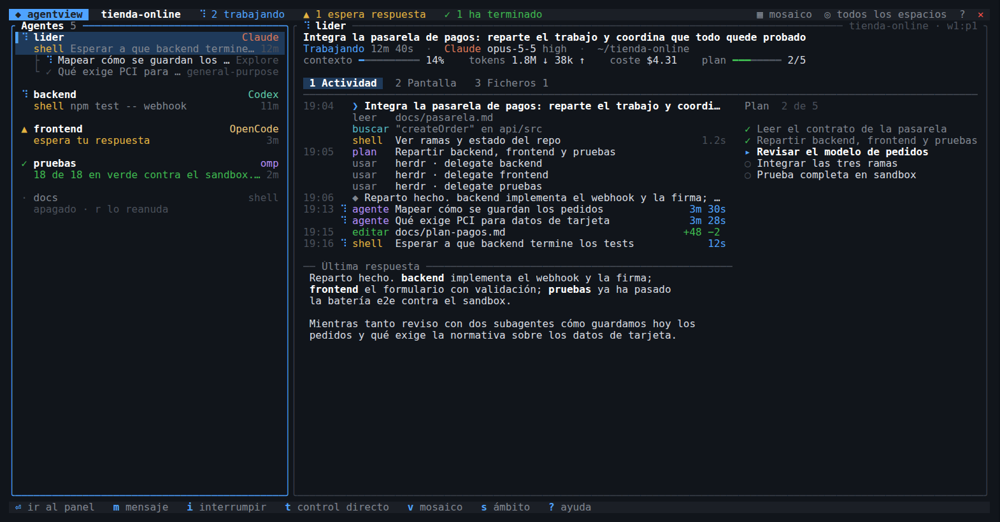
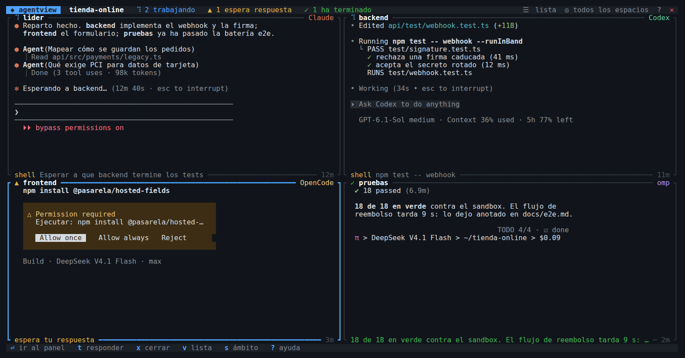

<div align="center">

# 🛰️ herdr-agentview

### *Qué hace cada uno de tus agentes, en vivo, y cómo pararlo, hablarle o reanudarlo*

[](https://www.rust-lang.org)
[](https://ratatui.rs)
[](https://herdr.dev)
[](docs/ia.md)
[](LICENSE)

**Centro de control para varios agentes de código (Claude Code, Codex, OpenCode, omp…) corriendo en paneles de [herdr](https://herdr.dev). Un popup que se abre sobre el panel activo.**

</div>

---



## ✨ Qué hace

- **Lista y detalle en vivo** de cada agente: estado (trabajando, espera respuesta, terminado, atascado), tarea, modelo y esfuerzo, contexto usado, tokens y coste, plan y últimas acciones leídas del propio transcript de la sesión.
- **Subagentes** anidados bajo su agente, con su propio detalle.
- **Mosaico** con la pantalla real de cada panel, para vigilar a todos a la vez.
- **Actuar sin cambiar de panel**: enviar un mensaje (a uno o a varios marcados), decirle que continúe, interrumpir el turno, teclear en su panel (control directo), reanudar un agente apagado y lanzar uno nuevo.
- **Explicar con IA** (`e`): qué está haciendo un agente y por qué, a partir de una foto acotada de su actividad. Ver [docs/ia.md](docs/ia.md).
- Fuentes: Claude Code, Codex, OpenCode y omp.



## 🚀 Instalación

Requiere [herdr](https://herdr.dev) ≥ 0.9 y Rust.

```sh
cargo build --release
herdr plugin link .            # plugin local.agentview
```

Atajo en `~/.config/herdr/config.toml`:

```toml
[[keys.command]]
key = "prefix+alt+a"
type = "plugin_action"
command = "local.agentview.open"
```

Pruebas sin herdr: `herdr-agentview --demo`. Un fotograma como HTML: `--render 150x44 --keys "v"`.

## 🤖 IA configurable por variables de entorno

Cualquier endpoint compatible con OpenAI Chat Completions (streaming):

```sh
export AGENTVIEW_AI_MODEL=mi-modelo
export AGENTVIEW_AI_API_URL=https://mi-proveedor/v1/chat/completions
export AGENTVIEW_AI_API_KEY_VALUE=...     # nunca se guarda en disco
export AGENTVIEW_AI_EFFORT=high           # none|minimal|low|medium|high|max|xhigh
```

Plantilla en [`.env.example`](.env.example); detalle en [docs/ia.md](docs/ia.md). Sólo se consulta cuando pulsas `e`, y se omiten las líneas que parecen credenciales.

## ⚙️ Configuración

`~/.config/herdr-agentview/config.toml` (todo opcional): refresco, ámbito inicial, texto de «continuar», minutos para marcar un agente como atascado y cómo se lanza, reanuda e interrumpe cada tipo de agente.

## 📄 Licencia

[MIT](LICENSE) · software libre y de código abierto.
